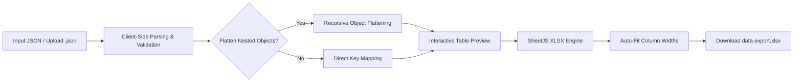

<div align="center">

# 📊 JSON to Excel Converter

### Fast, Free & 100% Client-Side In-Browser Spreadsheet Converter

[](https://astro.build/)
[](https://react.dev/)
[](https://tailwindcss.com/)
[](https://sheetjs.com/)
[](LICENSE)

<br />

<a href="https://json2excel.github.io/">
  
</a>

<br /><br />

**[🚀 Try Live Application](https://json2excel.github.io/)** • **[Report Bug / Request Feature](https://github.com/json2excel/json2excel.github.io/issues)** • **[☕ Support Developer](https://kisharadilshan.gumroad.com/coffee)**

</div>

---

## 🌟 Overview

**[JSON2Excel](https://json2excel.github.io/)** is a modern, privacy-first web utility designed to convert raw JSON data and `.json` files into formatted **Microsoft Excel (`.xlsx`)** spreadsheets directly inside your browser.

Traditional web converters upload your files to remote servers, exposing private data, API responses, customer details, and financial logs. **JSON2Excel runs entirely client-side** using browser memory and Web APIs—**zero bytes of your data ever leave your device**.

---

## ✨ Key Features

- **🔒 100% Client-Side Privacy**: All parsing, processing, and file generation happen in your browser using JavaScript and SheetJS. Zero tracking, zero server uploads, zero database storage.
- **⚡ Dual Input Modes**:
  - **Paste Raw JSON**: Live syntax validator with error indicators, character count, and indentation prettifier.
  - **Drag-and-Drop Zone**: Simply drag any `.json` file from your computer for instant in-memory reading.
- **🔄 Deep Object & Array Flattening**: Toggle recursive flattening with one click. Nested keys (e.g., `user.address.city`) cleanly become spreadsheet columns (`user_address_city`), while primitive arrays are neatly formatted.
- **👁️ Live Spreadsheet Preview**: Verify your columns, data types, and row counts in a clean interactive table before downloading.
- **📊 True Native `.xlsx` Generation**: Produces genuine OpenXML Excel workbooks with auto-calculated column widths—not generic unformatted CSV text.
- **📱 Fully Responsive Design**: Carefully crafted with Tailwind CSS for seamless mobile, tablet, and desktop viewports.
- **🛠️ Helpful Utilities**:
  - **Load Sample**: Pre-loaded mock dataset to test instant conversion.
  - **Prettify**: Format and indent messy or minified JSON.
  - **Quick Clear & Copy**: Instant clipboard and text management tools.
  - **Customizable Workbook**: Set custom output file and sheet names.

---

## 🚀 How It Works



1. **Input**: Paste your JSON text or drop a `.json` file into the dropzone.
2. **Validate & Configure**: Real-time syntax checking flags invalid JSON. Enable "Flatten nested objects" if dealing with complex hierarchies.
3. **Preview**: Verify your columns and first 5 rows in the live preview table.
4. **Export**: Click **Download Excel (.xlsx)** to trigger an instant in-memory workbook generation and browser download.

---

## 🛠️ Tech Stack

| Technology | Purpose |
| :--- | :--- |
| **[Astro 4](https://astro.build/)** | Static Site Generation (SSG) framework for ultra-fast performance |
| **[React 18](https://react.dev/)** | Interactive client island (`<JsonToExcel client:load />`) |
| **[Tailwind CSS](https://tailwindcss.com/)** | Utility-first styling with custom typography and emerald theme |
| **[SheetJS (`xlsx`)](https://sheetjs.com/)** | High-performance in-memory Excel workbook and worksheet generation |
| **[Lucide React](https://lucide.dev/)** | Clean, lightweight SVG icons |
| **[GitHub Actions](https://github.com/features/actions)** | Automated CI/CD build & deployment to GitHub Pages |

---

## 💻 Local Development

Follow these steps to run the project locally on your machine:

### Prerequisites

- **Node.js**: `v18.17.0` or higher (Node `v20+` recommended)
- **Package Manager**: `npm` (or `pnpm` / `yarn`)

### Installation & Setup

1. **Clone the repository:**
   ```bash
   git clone https://github.com/json2excel/json2excel.github.io.git
   cd json2excel.github.io
   ```

2. **Install dependencies:**
   ```bash
   npm install
   ```

3. **Start the local development server:**
   ```bash
   npm run dev
   ```
   Open your browser and navigate to `http://localhost:4321`.

4. **Build for production:**
   ```bash
   npm run build
   ```
   Generates a static production bundle in the `dist/` directory.

5. **Preview production build:**
   ```bash
   npm run preview
   ```

---

## 📂 Project Architecture

```
json2excel.github.io/
├── .github/
│   └── workflows/
│       └── deploy.yml          # GitHub Pages CI/CD workflow
├── public/
│   ├── favicon.svg             # Vector spreadsheet favicon
│   ├── robots.txt              # Search engine crawler directives
│   └── sitemap.xml             # XML sitemap with image extension
├── src/
│   ├── components/
│   │   └── JsonToExcel.jsx     # Interactive React island converter
│   ├── layouts/
│   │   └── Layout.astro        # SEO tags, OG metadata & layout shell
│   ├── pages/
│   │   └── index.astro         # Main landing page & Schema.org graph
│   └── styles/
│       └── global.css          # Tailwind base & custom scrollbar styles
├── astro.config.mjs            # Astro configuration with React & Tailwind
├── package.json                # Project dependencies and npm scripts
├── tailwind.config.mjs         # Tailwind theme customizations
└── tsconfig.json               # TypeScript configuration
```

---

## 📈 SEO & Performance Architecture

- **100% Technical SEO Score**: Comprehensive metadata, canonical URL tags, and Open Graph social cards.
- **Rich Schema.org Graph**: Injected with connected JSON-LD schemas:
  - `WebApplication`: Category, free pricing, and browser requirements.
  - `HowTo`: Structured step-by-step conversion instructions.
  - `FAQPage`: Rich accordion questions and answers for Google SERPs.
  - `BreadcrumbList`: Search result navigation trails.
- **Lighthouse Performance**: Near-perfect 100/100 Core Web Vitals with zero server latency and minimal runtime JavaScript.

---

## 🤝 Contributing

Contributions, issues, and feature requests are welcome!

1. Fork the Project.
2. Create your Feature Branch (`git checkout -b feature/AmazingFeature`).
3. Commit your Changes (`git commit -m 'Add some AmazingFeature'`).
4. Push to the Branch (`git push origin feature/AmazingFeature`).
5. Open a Pull Request.

---

## 📄 License

Distributed under the **MIT License**. See [`LICENSE`](LICENSE) for more information.

---

## ☕ Support

If you find this free tool helpful, consider supporting the developer:

[](https://kisharadilshan.gumroad.com/coffee)

<div align="center">
  <sub>Built with ❤️ for developers, data analysts, and privacy-conscious users worldwide.</sub>
</div>
